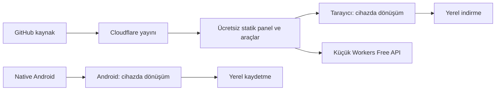

# Cloudflare mimari kararı

Güncel kullanıcı kararı: **Workers Free planında kalınır.** GitHub yalnızca kod
reposudur; tüm sunucu bileşenleri Cloudflare üzerinde, dönüşümler kullanıcı
cihazında çalışır. Ücretli Containers planı etkinleştirilmez.

| Sorumluluk | Etkin seçim |
|---|---|
| Panel ve codec dosyaları | Workers Static Assets; statik istekler ücretsiz ve sınırsız |
| Küçük health/capabilities API | Workers Free; hesap genelinde günlük 100.000 istek, çağrı başına 10 ms CPU |
| Görüntü | Web Worker + tarayıcı codec'leri; Android platform decode/encode |
| PDF | Cihazda pdf-lib: birleştirme, sayfa çıkarma/sıralama, döndürme ve görselden PDF |
| Excel/veri | Cihazda Papa Parse, ExcelJS ve sınırlandırılmış ZIP açma |
| Ses | Cihazda Web Audio decode; Web Worker içinde WAV/PCM16 veya MP3 encode |
| Kısa video | Canvas/MediaRecorder ile WebM; kaynak ses Opus olarak işlenir |
| Dosyalar | Cihaz belleği ve yerel indirme; sunucuya yükleme yok |
| Yayın | Codex'ten Wrangler; GitHub→Cloudflare Workers Builds bağlantısı henüz kurulmadı |

`npm run deploy` yalnızca `wrangler.web.jsonc` dağıtır. `run_worker_first` sadece
`/api/*` ve `/.well-known/*` yollarını kapsar; diğer istekler asset hizmetinden
sunulur. `public/_headers` aynı CSP ve güvenlik başlıklarını statik dosyalara ekler.
Dönüşüm kütüphaneleri kendi domainimizden yüklenir; harici codec CDN çağrısı yoktur.

PDF/tablo ve WAV/MP3 kodlama ayrı Web Worker içinde çalışır; iptal veya 30 saniye
sınırında worker sonlandırılır. Excel açılmış boyutu 32 MB/1.000 ZIP parçasıyla
sınırlanır. Girdi/sayfa/satır/hücre sınırları ve kayıplar arayüzde gösterilir.
Şifreli/formlu PDF, formüllü/makrolu/dış bağlantılı XLSX ve iç içe JSON reddedilir.
Bunlar dosyaların tamamen zararsızlaştırıldığı iddiası değildir; PDF çıktısı
önizlemede uygulama sayfasında çalıştırılmaz.

Ses en fazla 10 MB/120 saniye/2 kanal; video 25 MB/60 saniye/1920×1080.
Giriş codec desteği tarayıcıya bağlıdır. Video çıkışı kayıplıdır ve gerçek zamanlı
ilerler; sekme arka plana giderse işlem durur. Kare hassasiyetli/kayıpsız kesme,
HDR, altyazı veya çok kanallı ses aktarımı garantisi yoktur. WAV çıktısı kaynakta
kaybolan ses kalitesini geri getirmez. Her dosya her biçime çevrilemez.

Daha önce oluşturulan D1 `converter-mce`, özel R2 `converter-mce-files` ve Queue
`converter-mce-jobs` mevcut üretime bağlı değildir. Migration ve `jobs/` bir günlük
lifecycle uygulanmıştır. R2'nin ücretsiz kotası aşılınca ücretlenebilen bir hizmet
olduğu için ücretsiz üretim R2'ye dosya yazmaz. Hesaptaki diğer kaynaklara ve
önceden var olan aboneliklere dokunulmaz.

Sunucu taslağı `wrangler.jsonc`, Worker/Container kodu ve yerel Docker testlerinde
korunur; güncel dağıtım hedefi değildir. Yerel native Containers emülasyonu host
kernel/iptables eksiğiyle çalışmadığından aynı imajla ağ kapalı relay kullanılır.
Sunucu taslağındaki Access/D1/R2/Queues akışı ücretsiz üretimde etkin değildir.

Reklam ve Play Store yayını henüz yoktur. Android belge/medya modülleri, test
reklamları, gizlilik/izin akışı, release imzası ve mağaza doğrulaması sonraki işlerdir.
Güncel kotalar: [FREE-PLAN.tr.md](FREE-PLAN.tr.md).

ExcelJS ve medya/PDF panelleri ihtiyaç olduğunda yüklenir. Belge worker
ve tek kitap önbelleği panel kapanana veya işlem iptal edilene kadar yaşar.
Performans kanıtı: [PERFORMANCE.tr.md](PERFORMANCE.tr.md).
