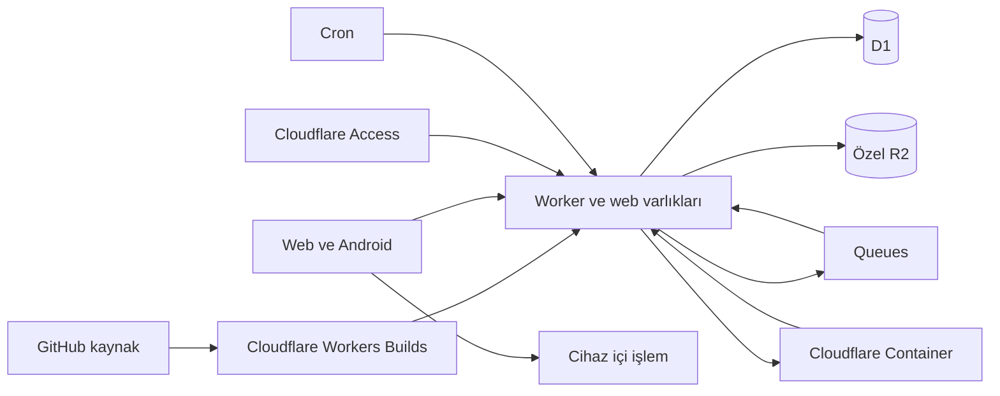

# Cloudflare mimari kararı

Kullanıcı kararı: GitHub yalnızca kaynak kod deposu; sunucu tarafındaki tüm
uygulama işlemleri Cloudflare üzerinde. Önceki FastAPI/PostgreSQL/Redis hizmet
önerileri bu kararla değiştirilmiştir. Android cihaz içi işlemler ile Play Store
ve reklam ağı entegrasyonu ürünün istemci/dağıtım tarafındaki ayrı bileşenleridir.

| Sorumluluk | Seçim |
|---|---|
| Web uygulaması | React/TypeScript, Vite build, Workers Static Assets |
| HTTP API ve sahiplik | TypeScript Worker; ilk kontrollü beta için Cloudflare Access |
| İşler ve kotalar | D1, koşullu SQL ekleme, kullanıcı/işlem anahtarı tekilliği |
| Özel dosyalar | R2; indirme Worker sahiplik kontrolünden geçer |
| İş teslimi | Queues, sınırlı tekrar, D1 outbox/lease kurtarma |
| CPU motorları | Cloudflare Containers + Durable Objects; iki sabit shard |
| Dosya temizliği | Cron Trigger; 24 saat erişim TTL, beş dakikalık temizlik döngüsü |
| Koddan yayın | Cloudflare Workers Builds + GitHub kaynak bağlantısı |
| Android build artefaktları | Sonraki aşama: Cloudflare build Container ve özel R2 |
| İzleme | Cloudflare Workers/Containers Logs ve yerel hata kodları |

Worker görüntüyü yalnızca boyut/başlık düzeyinde inceler; ağır decode/encode
Container içinde olur. Normal Worker'a FFmpeg veya LibreOffice kurulmaz.
Web Worker ve Android platform codec'leri cihaz içi maliyeti azaltır. Daha sonra
video/ses/PDF/Office motorları ayrı Cloudflare Container imajlarına eklenir.

Üretim imajı root olmayan kullanıcıyla çalışır ve internet erişimi kapalıdır.
Kullanıcı komut satırı, URL veya çalıştırılabilir kod sağlayamaz. Çıktı her deneme
için farklı nesneye yazılır; yalnızca geçerli lease başarılı sonucu yayınlar.
Silme ve başarısız eski deneme daha yeni bir sonucu silemez.

Yerel geliştirme ortamının kernel/iptables eksiği native Wrangler container
proxy'sini engelledi. Geliştirme relay'i aynı üretim imajında `--network=none`,
salt okunur disk, yetki ve kaynak limitleriyle dönüşümü çalıştırır. Üretimde
relay veya başka bir sunucu kullanılmaz. Bu ayrım canlı Cloudflare çalışmasının
henüz kanıtlanmadığı anlamına gelir; yerel test geçmesi canlı hesap testi sayılmaz.

İlk sürümde R2'ye en fazla 10 MB dosya Worker üzerinden akış limitleriyle alınır.
Büyük video geldiğinde R2 multipart/doğrudan yükleme ayrı yetkilendirilmiş
oturumlarla kurulacak; büyük dosyalar tek Worker belleğine alınmayacaktır.

Reklamlar henüz etkin değildir. Kullanıcıdan ücret alınmaz; limitler ve cihaz
içi işleme işlem maliyetini yönetir. Cloudflare hesap ve hizmet ücretleri gerçek
hesapta kontrol edilir; reklam geliri sınırsız işlem garantisi olarak kullanılmaz.

23 Ekim 2026: token/hesap erişimi doğrulandı, D1/R2/Queue oluşturuldu; D1 şeması
ve özel R2'nin bir günlük lifecycle kuralı uygulandı. Cihazda dönüşüm sürümü
https://converter-mce.sosyalstudio-06a486e459d2.workers.dev adresinde yayında.
`wrangler.web.jsonc` yalnızca ASSETS binding'iyle çalışır; sunucu API'si kapalıdır.
Canlı mobil Chromium testi gerçek JPEG dönüşümü, piksel/boyut, indirme ve
dosyanın sunucuya gönderilmediğini doğruladı.

Cloudflare Containers erişimi Workers Paid planı gerektiği gerekçesiyle
reddedildi. Aylık minimum 5 ABD dolarlık plan ve ek kullanım ücretleri kullanıcı
onayı bekliyor; yeni abonelik satın alınmadı. Sonraki adımlar: ücretli plan,
Access uygulaması, tam `wrangler.jsonc` dağıtımı; ardından canlı Container,
dönüşüm, sahiplik, silme ve cron testi. Workers Builds kaynak bağlantısı da
henüz kurulmadı. Android reklam/izin akışı,
release imzası ve Play yayını ayrı sonraki teslimattır.
